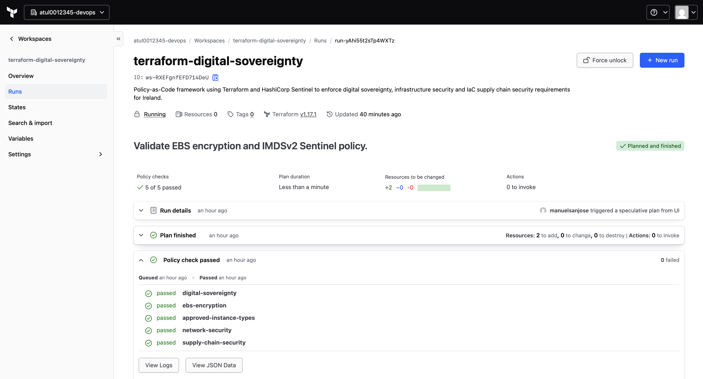
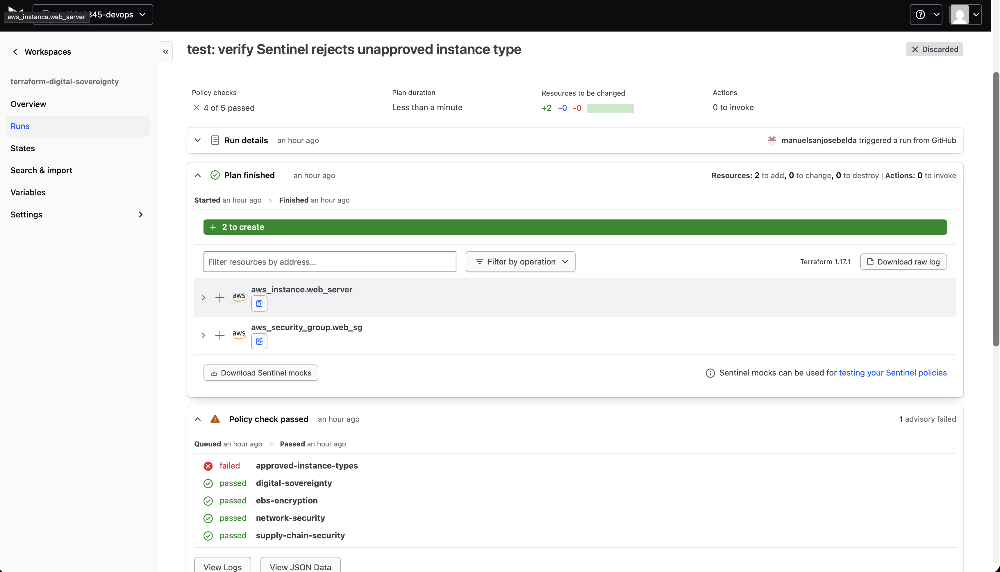
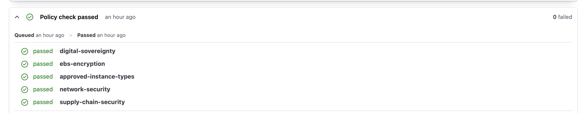

# Terraform Digital Sovereignty & IaC Supply Chain Security

## 1. Project Overview

This project focuses on building a Policy-as-Code framework for organisation **ATUL0012345**, using Terraform, HashiCorp Sentinel, HCP Terraform and GitHub.

The main objective is to check infrastructure configurations before deployment and make sure they follow a set of security and governance rules. These include restricting the AWS deployment region, requiring encrypted EBS storage, limiting EC2 instance types, controlling network access and checking the Terraform provider and module configuration.

The policies are tested through HCP Terraform plan runs and local Sentinel tests. I also tested a non-compliant configuration by using an unapproved EC2 instance type to confirm that Sentinel detected the issue.

No AWS infrastructure was actually deployed as part of this project. All tests were carried out using Terraform plans and Sentinel evaluations, without running an Apply operation.

## 2. Architecture & Workflow

The project uses GitHub to store and manage the Terraform configuration, Sentinel policies and test files.

The repository is connected to an HCP Terraform workspace. Whenever changes are pushed to the `develop` branch, HCP Terraform automatically starts a new run and generates a Terraform plan.

The workflow is:

1. **GitHub:** Stores the Terraform configuration and Sentinel policies. Changes are tracked through Git commits.
2. **Terraform:** Defines the AWS infrastructure, including an EC2 instance and its security group.
3. **HCP Terraform:** Runs Terraform remotely whenever changes are pushed to the connected branch.
4. **Sentinel:** Evaluates the configuration and proposed changes against the five policies configured in the policy set.

During development and testing, I chose **advisory enforcement** so I could observe the results of all five policies without interrupting the workflow. This made it easier to identify issues, test different configurations and understand how each policy behaved.

In a production environment, I would change the enforcement level to **hard-mandatory**. This would ensure that any run failing a mandatory policy is blocked before reaching the Apply stage, preventing non-compliant infrastructure from being deployed.

For this assignment, I only used plan runs and policy evaluations. I did not apply the configuration or create any AWS resources.

## 3. Repository Structure

The repository is organised to keep the Terraform configuration, Sentinel policies and their tests separate.

```text
terraform-digital-sovereignty/
├── terraform/
│   ├── main.tf
│   ├── providers.tf
│   ├── variables.tf
│   ├── versions.tf
│   ├── .terraform.lock.hcl
│   ├── tfplan
│   ├── plan.json
│   └── sentinel/
│       ├── sovereignty.sentinel
│       ├── encryption.sentinel
│       ├── instance_type.sentinel
│       ├── network.sentinel
│       ├── supply_chain.sentinel
│       ├── sentinel.hcl
│       ├── test/
│       │   ├── encryption/
│       │   │   ├── encryption.hcl
│       │   │   └── encryption-fail.hcl
│       │   ├── instance_type/
│       │   │   ├── instance_type-pass.hcl
│       │   │   └── instance_type-fail.hcl
│       │   ├── network/
│       │   │   ├── network-pass.hcl
│       │   │   └── network-fail.hcl
│       │   ├── sovereignty/
│       │   │   ├── pass.hcl
│       │   │   └── fail.hcl
│       │   └── supply_chain/
│       │       ├── supply_chain-pass.hcl
│       │       └── supply_chain-fail.hcl
│       └── testdata/
│           ├── mock-tfplan-unencrypted.sentinel
│           ├── mock-tfplan-encrypted.sentinel
│           ├── mock-tfconfig-v2.sentinel
│           ├── mock-tfconfig-v2-fail.sentinel
│           ├── mock-tfplan-instance-approved.sentinel
│           ├── mock-tfplan-instance-rejected.sentinel
│           ├── mock-tfconfig-supply-chain-pass.sentinel
│           ├── mock-tfconfig-supply-chain-fail.sentinel
│           ├── mock-tfplan-network-safe.sentinel
│           └── mock-tfplan-network-unsafe.sentinel
└── plan-output.txt
```

The `terraform/` directory contains the infrastructure configuration and generated plan files. The `sentinel/` directory contains the five policies and their corresponding tests.

Each policy has its own test directory, with separate cases for compliant and non-compliant configurations. The `testdata/` directory contains mock configurations and plans used to simulate different scenarios. This allows the policies to be tested locally without creating real AWS resources.

## 4. Sentinel Policies & Design Justifications

I implemented five Sentinel policies to check different aspects of the infrastructure before deployment. Each policy focuses on a specific security or governance requirement.

| Policy                      | What it checks                                                                                                                                                                                          | Why it is needed                                                                                              |
| --------------------------- | ------------------------------------------------------------------------------------------------------------------------------------------------------------------------------------------------------- | ------------------------------------------------------------------------------------------------------------- |
| **Digital Sovereignty**     | Restricts the AWS provider region to `eu-west-1` (Ireland).                                                                                                                                             | Keeps the configured deployment region within Ireland and supports the project's data sovereignty objectives. |
| **EBS Encryption**          | Requires encrypted root EBS volumes and IMDSv2 (`http_tokens = "required"`) on EC2 instances.                                                                                                           | Protects data stored on the root volume and reduces the risk of exposing instance metadata credentials.       |
| **Approved Instance Types** | Only allows EC2 instance types `t3.micro` and `t3.small`.                                                                                                                                               | Keeps instance sizes within the approved list and helps control infrastructure costs.                         |
| **Network Security**        | Prevents unrestricted inbound access on all protocols and blocks unrestricted SSH access. It allows HTTP traffic on port 80 and restricts SSH access to the `10.0.0.0/8` range.                         | Reduces unnecessary exposure to the internet while allowing the web traffic required by the application.      |
| **Supply Chain Security**   | Checks that the AWS provider comes from `registry.terraform.io/hashicorp/aws`, that its version constraint is approved, and that Terraform modules meet the configured source and version requirements. | Reduces the risk of using untrusted providers or modules in the infrastructure configuration.                 |

The policies are evaluated by HCP Terraform during plan runs. They are also tested locally using Sentinel mock data, covering both compliant and non-compliant configurations.

Some of these controls have a limited scope. For example, the sovereignty policy checks the AWS provider region, but does not verify every resource's replication or backup settings. Similarly, the supply chain policy checks the declared configuration, but does not verify the integrity or signatures of downloaded provider binaries.

## 5. Digital Sovereignty Evaluation & Limitations

One of the main requirements of this project is to keep infrastructure deployments within an approved geographical region. To address this, I created a Sentinel policy that restricts the AWS provider configuration to `eu-west-1` (Ireland).

This provides a useful control because the region is checked automatically during the Terraform plan, rather than relying on someone to verify it manually.

However, restricting the provider region does not guarantee complete data residency or digital sovereignty. There are other aspects that need to be considered:

- **Backups and replication:** Some AWS services can replicate data, snapshots or backups across regions. These settings would need additional controls.
- **Administrative access:** Hosting resources in Ireland does not necessarily mean that all technical or administrative access takes place from Ireland or the EU.
- **Legal jurisdiction:** The physical location of infrastructure does not, by itself, determine every legal jurisdiction that may apply to a cloud provider or its services.
- **Policy scope:** The current policy checks the AWS provider region. It does not inspect every resource to verify its individual data storage, replication or backup configuration.

For a production environment, I would extend these controls to cover specific services such as S3 and RDS, review backup and replication settings, and apply additional access controls to administrative operations.

## 6. IaC Supply Chain Security

Terraform relies on external providers and modules to interact with cloud services and build infrastructure. Since these components become part of the deployment process, using untrusted or compromised dependencies can introduce security risks.

To reduce these risks, I implemented a Sentinel policy with the following checks:

- **Approved provider source:** Only allows the official AWS provider from `registry.terraform.io/hashicorp/aws`.
- **Provider version constraint:** Checks that the provider uses the approved `~> 5.0` version constraint.
- **Module sources:** Checks module sources and versions against an approved list. No external Terraform modules are currently used in this project.

I also committed the `.terraform.lock.hcl` file to GitHub. It records the selected AWS provider version (`5.100.0`) and its checksums, helping Terraform install consistent provider packages across environments.

There are still some limitations to consider. Sentinel checks the provider and module configuration, but it does not independently verify the integrity of downloaded binaries, validate publisher signatures or scan dependencies for known vulnerabilities.

For a production environment, I would add automated dependency scanning, verify signed releases where supported, and use pinned module versions or immutable commit references. These additional checks would provide stronger protection against compromised or untrusted dependencies.

## 7. Testing & Validation Evidence

I tested the Sentinel policies locally using the Sentinel CLI and mock data before connecting them to HCP Terraform.

All five policies passed their local tests, covering both compliant and non-compliant scenarios.

I then connected the GitHub repository to HCP Terraform to test the policies against actual Terraform plan runs.

### Compliant Plan

With the AWS region set to `eu-west-1`, an approved `t3.micro` instance type, encrypted root EBS storage, IMDSv2 enabled and restricted SSH access, all five Sentinel policies passed in HCP Terraform.

The screenshot below shows the successful policy evaluation.



### Non-Compliant Plan

To test whether the policies detected an invalid configuration, I temporarily changed the EC2 instance type to `t3.large` and pushed the change to GitHub.

HCP Terraform automatically started a new run. The `approved-instance-types` policy failed because `t3.large` was not included in the approved list (`t3.micro` and `t3.small`). The other four policies passed.

After this test, I restored the original configuration using the approved instance type.

The screenshot below shows the failed policy evaluation.



### Local Sentinel Tests

I also ran the Sentinel tests locally to check that the policies behaved as expected using mock data.



All five policy test suites passed.

I also saved the Terraform plan output and generated plan files in the repository. No Apply operation was performed during these tests.

## 8. Plan-Time Limitations & Maintenance Challenges

Sentinel provides a useful way to check infrastructure changes before they are applied. However, there are some limitations that need to be considered when using it in a real environment.

1. **No automatic drift prevention:** Sentinel evaluates Terraform runs, but it does not prevent someone from making changes directly through the AWS Console or other tools. Additional monitoring, such as AWS Config, would be needed to detect these changes.

2. **Keeping policies up to date:** AWS and its Terraform provider change over time. New resources and attributes may require updates to existing policies. The policies should therefore be reviewed and tested whenever the provider version is upgraded.

3. **Policy exceptions:** Some rules may need to be adjusted as infrastructure requirements change. For example, restricting EC2 instances to only two types might not suit every workload. A clear approval process would help manage exceptions without weakening security controls.

4. **Limitations of plan-time checks:** Sentinel evaluates the configuration and planned changes available during a Terraform run. It cannot guarantee that the infrastructure will remain compliant after deployment or inspect every aspect of the cloud provider's internal operations.

For a production environment, I would complement Sentinel with AWS Config for continuous compliance monitoring, customer-managed KMS keys for stronger encryption control, and AWS Service Control Policies (SCPs) to enforce additional restrictions at the account level.

These measures would help cover some of the gaps that cannot be addressed by Sentinel alone.

## 9. AI Tool Disclosure

OpenAI ChatGPT (GPT-6) was used as a support tool during the development of this project.

As I had never worked with HashiCorp Sentinel before, I used ChatGPT to get a general introduction to the tool, understand how its policies work, how to structure them and how to run tests using mock data.

During development, I also used it whenever I ran into problems or needed clarification. For example, when a Sentinel test was failing, when I had difficulties with policy syntax or when an evaluation did not behave as expected. I also used it to better understand parts of the Terraform and Sentinel documentation and some of HashiCorp's concepts and features.

**Example prompt used:**

> "Why is my HashiCorp Sentinel test failing with a mock tfplan file when checking root_block_device encryption on an aws_instance, and how should I structure the rule?"

Overall, I used it as a learning and troubleshooting resource. I independently designed the repository structure, wrote and adjusted the Terraform and Sentinel configurations, configured the GitHub and HCP Terraform integration, and carried out all compliant and non-compliant test evaluations.
